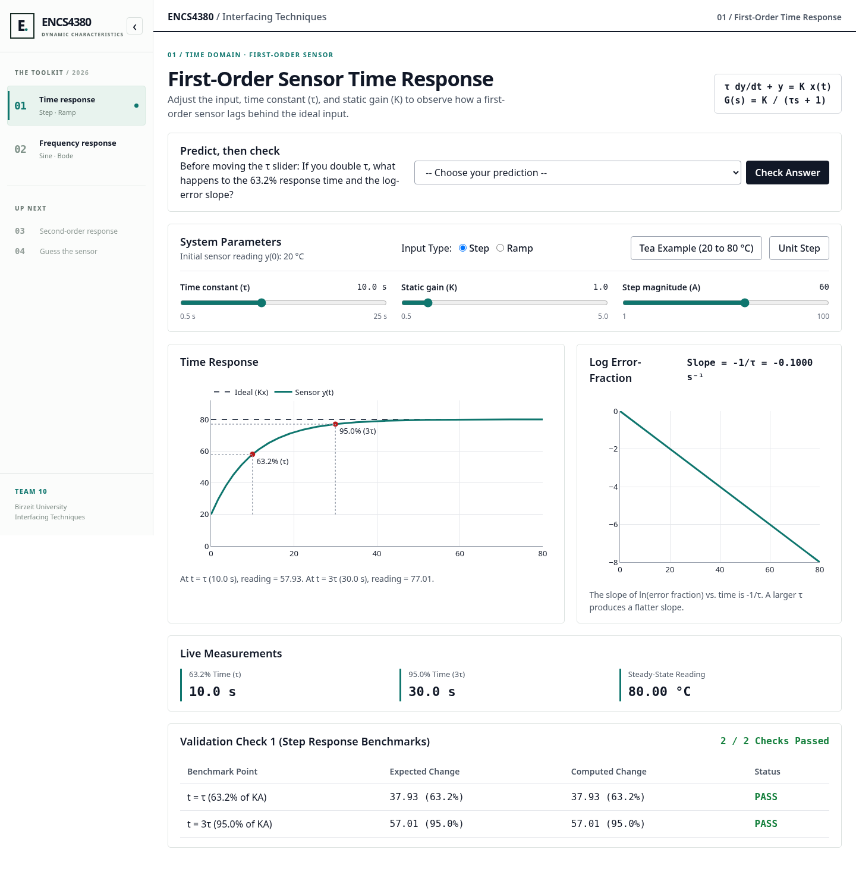
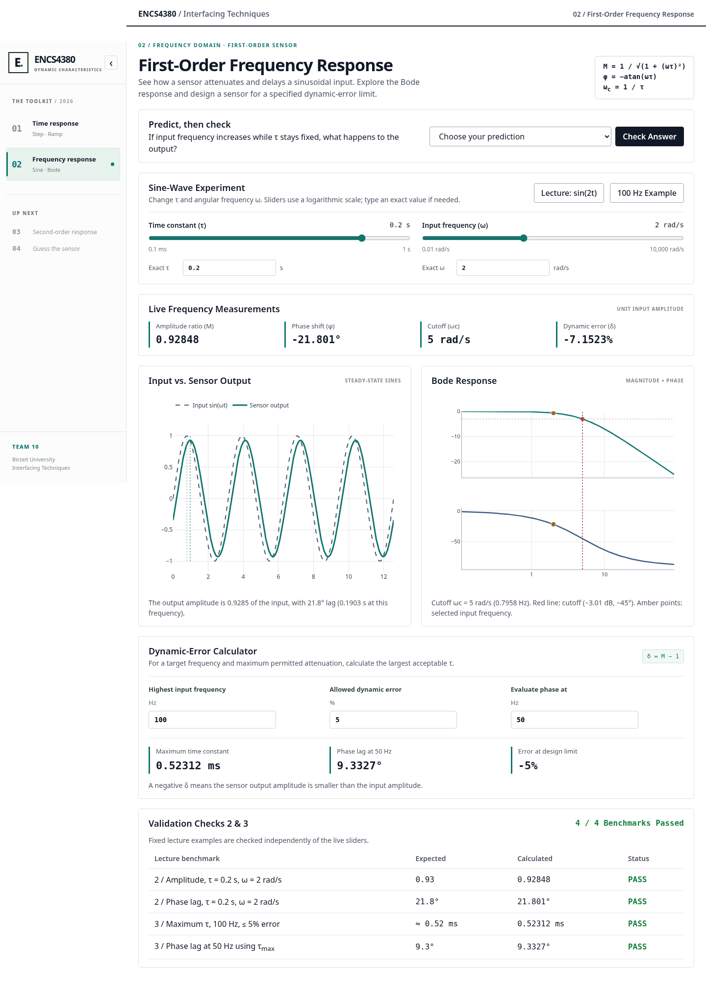
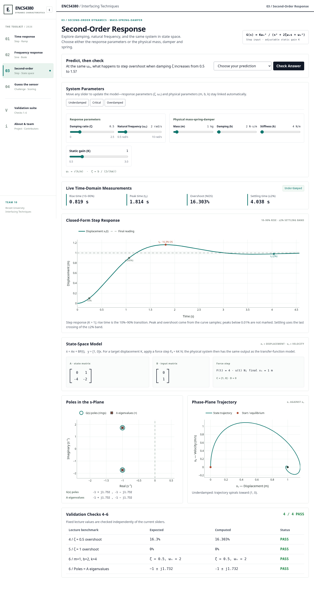
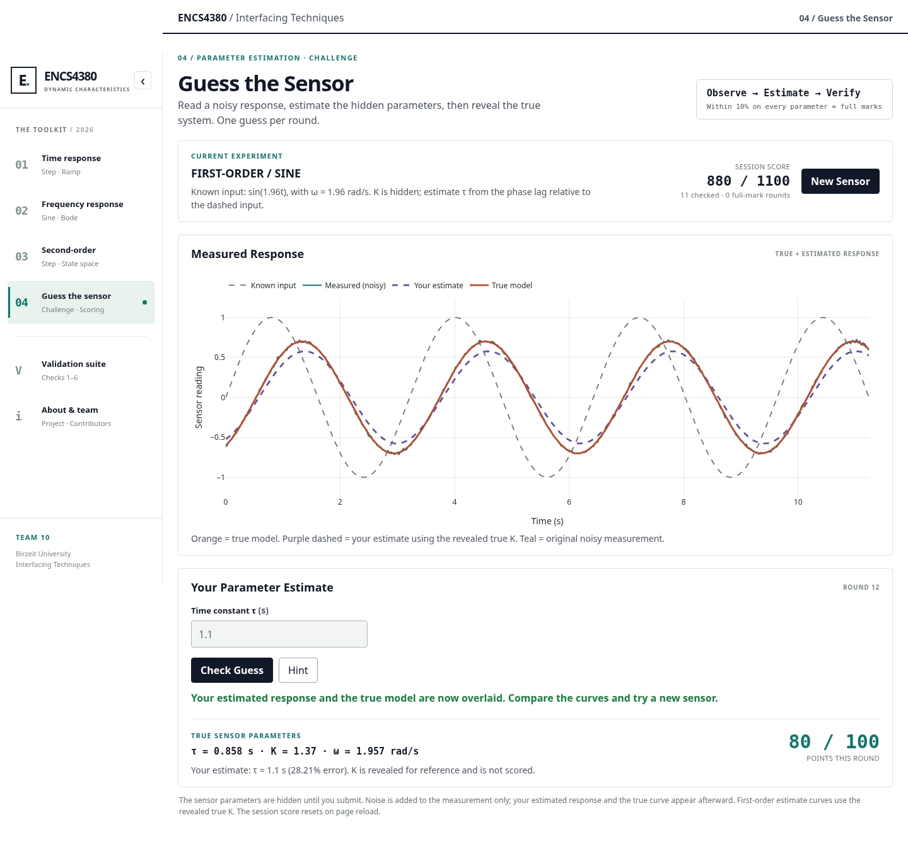
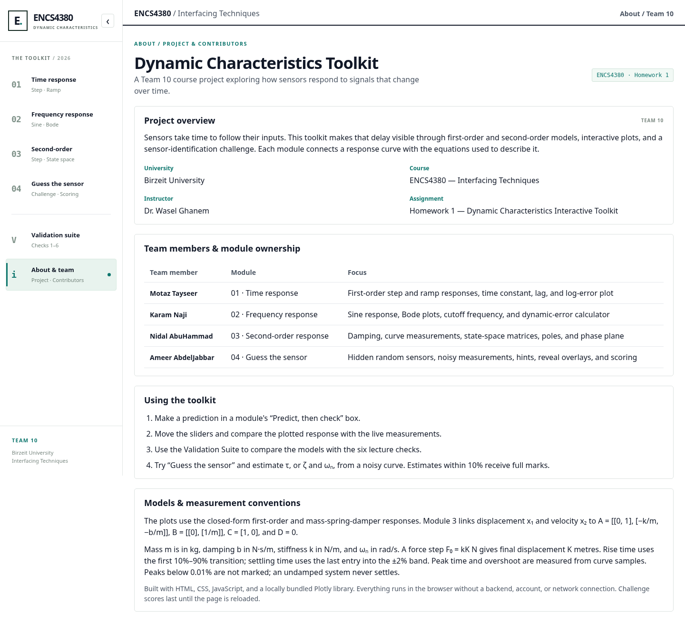
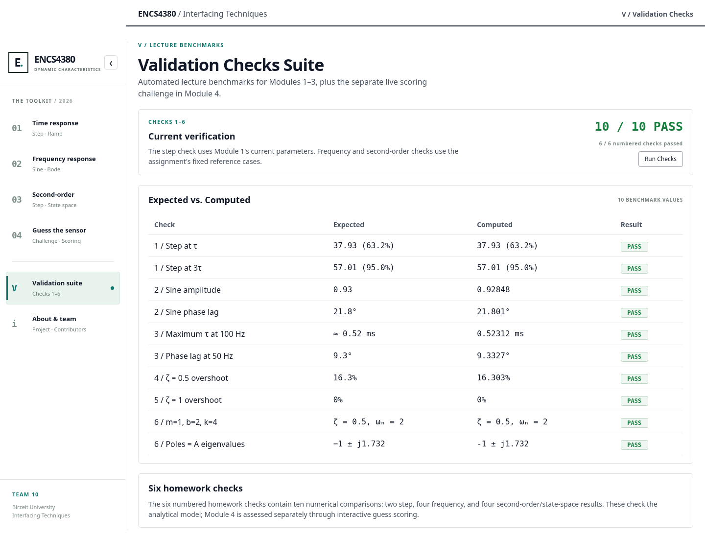
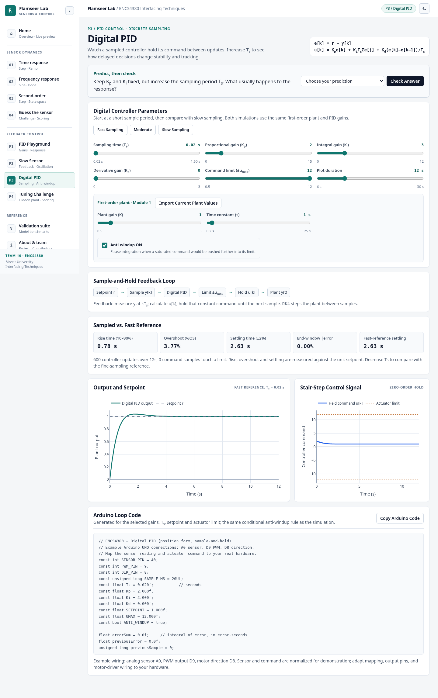
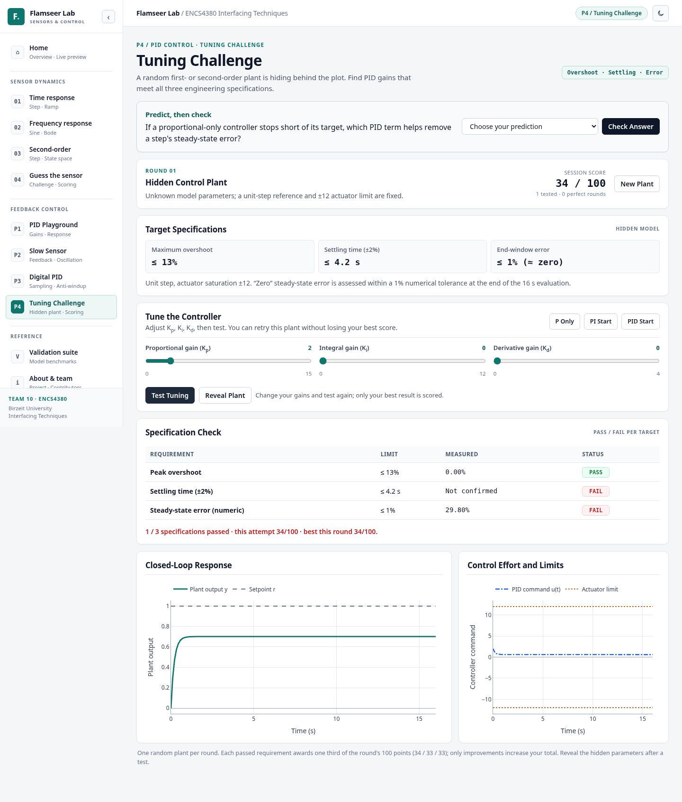

# ENCS4380 — Flamseer Lab (Dynamics & Control Toolkit)

Interactive web toolkit for **ENCS4380 Interfacing Techniques**, Birzeit University.

**Instructor:** Dr. Wasel Ghanem  
**Assignments:** Homework 1 (Sensor Dynamics) & Homework 2 (PID Control: P1–P4)  
**Group:** Team 10  
**Project Pages URL:** https://motazalt.github.io/encs4380-dynamics-flameseer/

## Overview

- **Home — Interactive Overview:** Live RK4 Response Monitor comparing first-order step, PID closed-loop tracking, and slow-sensor feedback lag, with quick navigation to all modules and light/dark theme support.
- **Module 1 — First-Order Time Response:** Step/ramp responses, 63.2% and 95% markers, ramp lag and steady-state error, and a sampled error-fraction plot on a logarithmic axis. The time window follows τ, and the natural-log slope is −1/τ.
- **Module 2 — First-Order Frequency Response:** Input/output sines, amplitude ratio and phase lag, Bode plots with cutoff at 1/τ, and a dynamic-error calculator.
- **Module 3 — Second-Order Response & State Space:** Linked ζ/ωₙ and m/b/k sliders, damping regimes, curve measurements, live A/B matrices, poles and eigenvalues, and a phase-plane trajectory.
- **Module 4 — Guess the Sensor:** Random hidden first-order step/sine and underdamped second-order step sensors, noisy measurements, hints, true/estimated response overlays, and session scoring.
- **P1 — PID Playground (`#control-p1`):** Interactive `Kp`, `Ki`, and `Kd` tuning on Module 1 or Module 3 plants with actuator limits (`±umax`), live rise time, peak time, overshoot, settling time, steady-state error, and closed-loop validation checks.
- **P2 — Slow Sensor in the Feedback Loop (`#control-p2`):** Fast Sensor, Overshoot, and Sustained Oscillation presets comparing true plant output `y` against a delayed first-order sensor reading `ym`.
- **P3 — Digital PID (`#control-p3`):** Sampled position-form PID with RK4 plant integration, zero-order-held PWM commands, adjustable sampling time, anti-windup toggle, live performance comparisons, and copyable Arduino sketch matching the current gains.
- **P4 — PID Tuning Challenge (`#control-p4`):** Hidden random first- or second-order plants, overshoot/settling/error limits, pass/fail per requirement, unlimited retests, reveal and a per-round best-session score.
- **Validation Suite:** All six Homework 1 lecture checks (10 numerical comparisons) plus the Homework 2 closed-loop PID validation checks.
- **About & Team:** Course and project information, module ownership, a usage guide, and model/measurement conventions.

Modules 1–3 and P1–P4 each include a “Predict, then check” prompt. The interface supports persistent Light and Dark modes, a collapsible desktop sidebar, and a keyboard-accessible mobile drawer.

## Run locally

Open `index.html` in a modern browser, or serve the directory locally:

```bash
python -m http.server 8000
```

Then open `http://localhost:8000/`. No build step, installation, backend, or login is required. Plotly is bundled locally, so the toolkit runs offline.

For GitHub Pages, upload the **contents** of this directory to the repository's published root. Keep the JavaScript, CSS, plotting library, and `screenshots/` paths intact.

## Team 10 — Module ownership

| Team member | Student ID | Module |
| --- | --- | --- |
| Motaz Tayseer | 1231596 | Module 1 — First-order time response |
| Karam Naji | 1230062 | Module 2 — First-order frequency response |
| Nidal AbuHammad | 1231481 | Module 3 — Second-order & state space; P1 & P2 PID control |
| Ameer AbdelJabbar | 1231192 | Module 4 — Guess the sensor |

**P3/P4 module owners:** Pending the team’s GitHub Issue assignments; update this table once confirmed.

## Measurements, simulation, and scoring

- **Closed-loop RK4 solver (P1 & P2):** Uses the first- and second-order plant differential equations with a 0.05 s derivative filter on the feedback signal and actuator clipping at `±umax`. P2 adds a first-order sensor state (`τs dy_m/dt + y_m = y`) in the feedback path.
- **P3 digital PID:** `u[k] = Kp e[k] + Ki Ts Σ(e[j]) + Kd (e[k] − e[k−1])/Ts`, clipped to `±umax`. Commands are held constant between sensor readings while RK4 solves the first-order plant. Anti-windup conditionally freezes integral accumulation if saturation would worsen. A fast `Ts=0.02s` reference uses the same plant, gains and anti-windup. The Arduino example assumes normalized `analogRead(A0)` and drives PWM on D9 with direction on D8; adapt for actual hardware.
- **P4 scoring:** Each plant has three specifications, worth 34, 33 and 33 points (overshoot, settling, and end-window error within 1%). Retest as often as desired; only improvements to the round best add to session points. Revealing plant parameters locks that round. The hidden plants are random first- or second-order models; a filtered derivative and actuator clipping match the P1 physics.
- **Module 3 conventions:** `m` is in kg, `b` in N·s/m, `k` in N/m, and `ωₙ` in rad/s. Force step `F₀ = kK` N gives final displacement `K` metres. Rise time is the first 10%–90% transition; settling time is the last entry into the ±2% band. At `ζ = 0`, the system never settles.
- **Challenge scoring (Module 4):** Each round is worth 100 points. Estimates within 10% of every true parameter earn full marks; partial credit decreases linearly with the largest relative error, reaching zero at 100% error. Totals reset on page reload.

## Project structure

| File | Purpose |
| --- | --- |
| `index.html` | Homepage, modules 1–4, P1–P4, validation, and About views |
| `styles.css` | Light/dark theme tokens, responsive interface, and sidebar |
| `charts.js` | Theme manager, shared Plotly styling, metric renderer, and container resizing |
| `module1.js` | Module 1 first-order time response |
| `module2.js` | Module 2 frequency response, validation dashboard, and shared navigation |
| `module3.js` | Module 3 dynamics and state space |
| `module4.js` | Module 4 challenge generation, response overlays, and scoring |
| `control.js` | P1 & P2 closed-loop RK4 simulator, validation checks, and homepage preview |
| `control-p3p4.js` | P3 sampled PID, Arduino code generation, P4 random-plant challenge, and scoring |
| `plotly.min.js` | Bundled Plotly library |
| `screenshots/` | Interface screenshots |

## Screenshots












## AI use

ChatGPT assisted with UI, implementation, and debugging.

