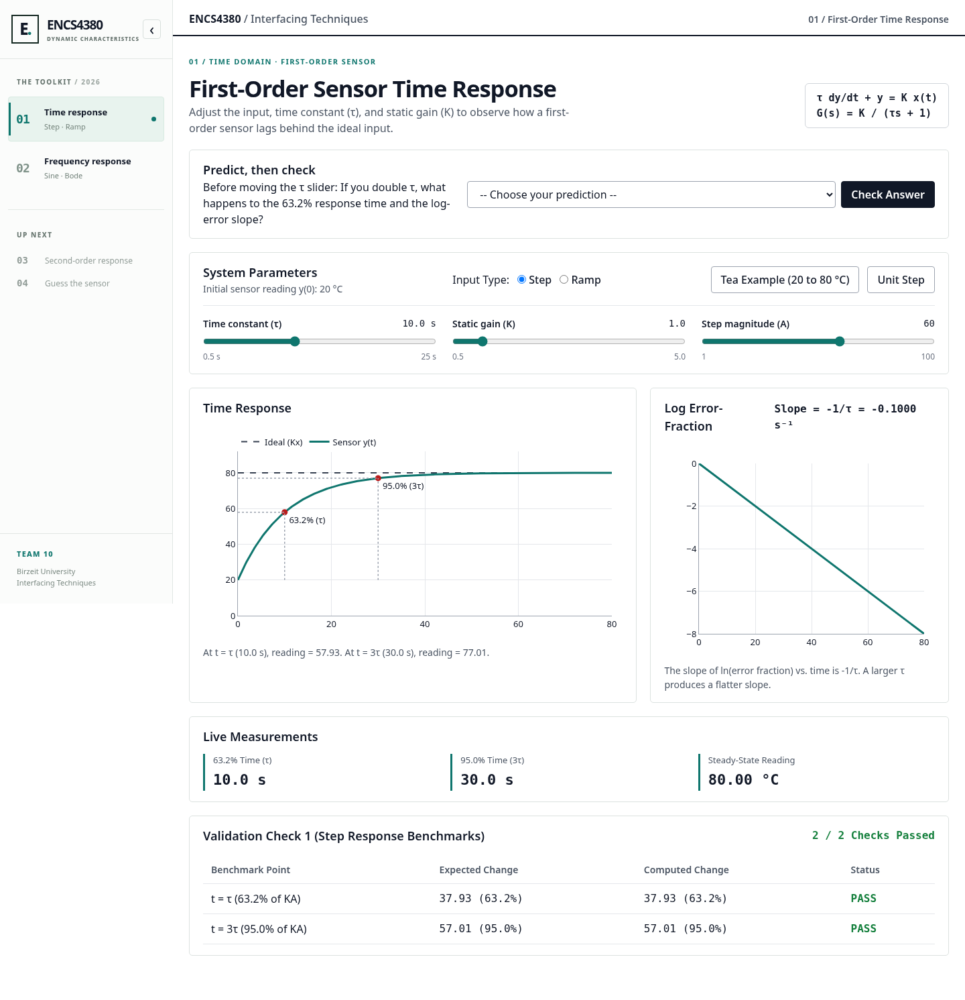
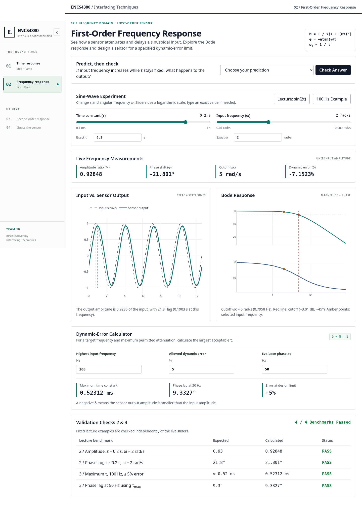
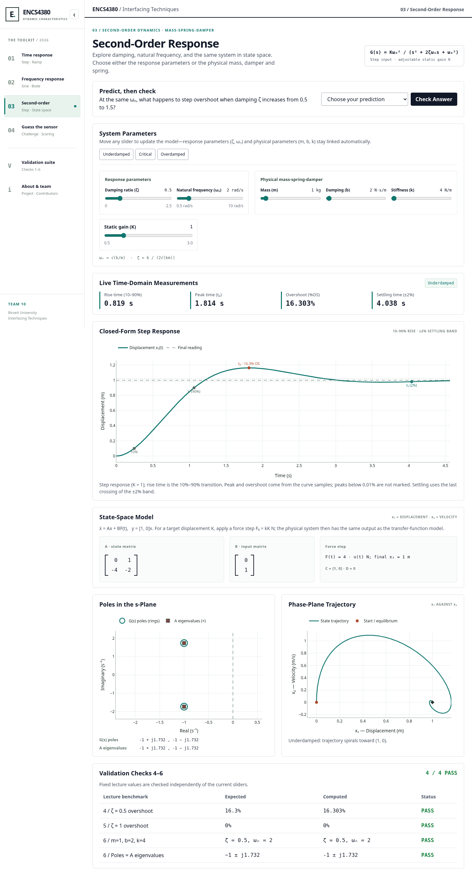
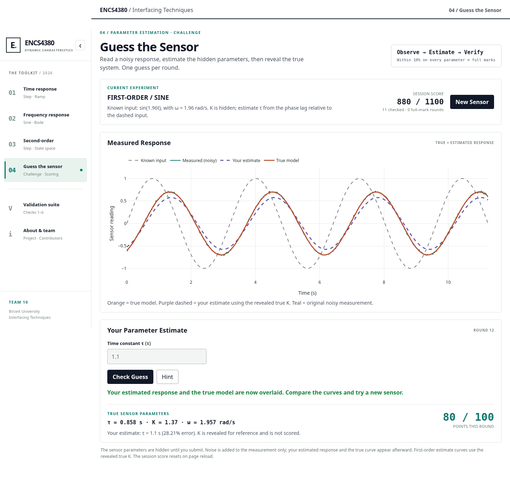
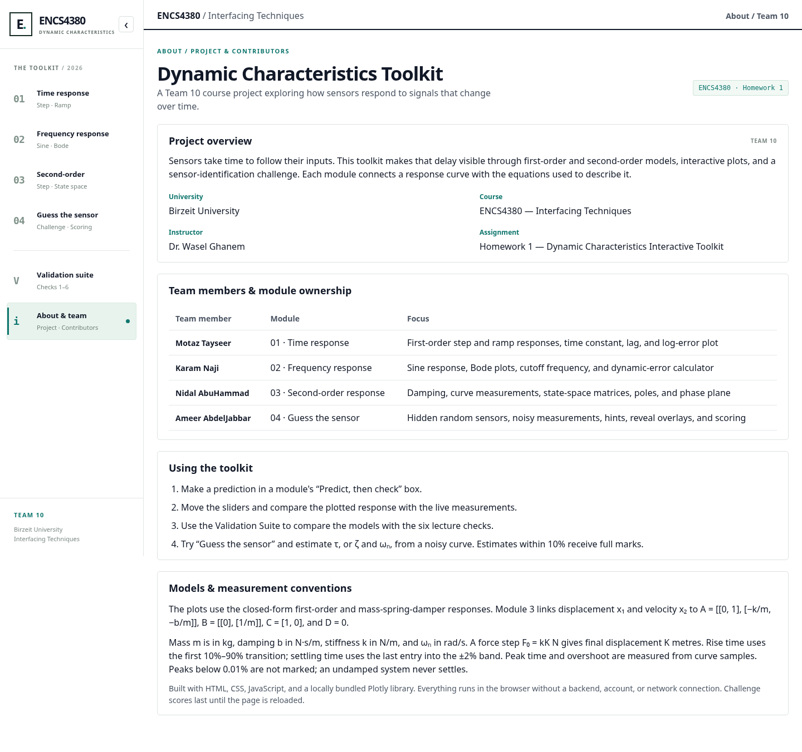
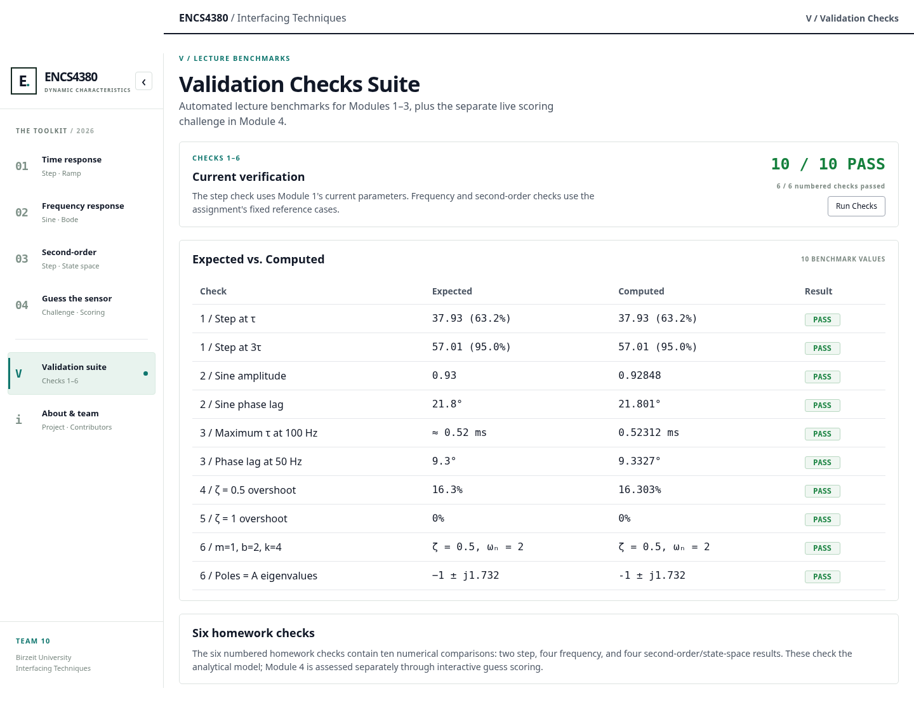

# ENCS4380 — Dynamic Characteristics Toolkit

Interactive web toolkit for **ENCS4380 Interfacing Techniques**, Birzeit University.

**Instructor:** Dr. Wasel Ghanem  
**Assignment:** Homework 1 — Dynamic Characteristics Interactive Toolkit  
**Group:** Team 10  
**Project Pages URL:** https://motazalt.github.io/encs4380-dynamics-flameseer/

## Overview

- **Module 1 — First-Order Time Response:** Step/ramp responses, 63.2% and 95% markers, ramp lag and steady-state error, and a sampled error-fraction plot on a logarithmic axis. The time window follows τ, and the natural-log slope is −1/τ.
- **Module 2 — First-Order Frequency Response:** Input/output sines, amplitude ratio and phase lag, Bode plots with cutoff at 1/τ, and a dynamic-error calculator.
- **Module 3 — Second-Order Response & State Space:** Linked ζ/ωₙ and m/b/k sliders, damping regimes, curve measurements, live A/B matrices, poles and eigenvalues, and a phase-plane trajectory. Either set of sliders can be used directly.
- **Module 4 — Guess the Sensor:** Random hidden first-order step/sine and underdamped second-order step sensors, noisy measurements, hints, true/estimated response overlays, and session scoring.
- **Validation Suite:** All six lecture checks, comprising ten numerical comparisons, with a Run Checks button.
- **About & Team:** Course and project information, module ownership, a usage guide, and model/measurement conventions.

Modules 1–3 include a “Predict, then check” prompt. The sidebar collapses on desktop and becomes a keyboard-accessible drawer on mobile.

## Run locally

Open `index.html` in a modern browser, or serve the directory locally:

```bash
python -m http.server 8000
```

Then open `http://localhost:8000/`. No build step, installation, backend, or login is required. Plotly is bundled locally, so the toolkit runs offline.

For GitHub Pages, upload the **contents** of this directory to the repository's published root. Keep the JavaScript, CSS, plotting library, and `screenshots/` paths intact.

## Team 10 — Module ownership

| Team member | Module |
| --- | --- |
| Motaz Tayseer | Module 1 — First-order time response |
| Karam Naji | Module 2 — First-order frequency response |
| Nidal AbuHammad | Module 3 — Second-order response and state space |
| Ameer AbdelJabbar | Module 4 — Guess the sensor |

## Measurements and scoring

For Module 3, m is in kg, b in N·s/m, k in N/m, and ωₙ in rad/s. The force step F₀ = kK N gives final displacement K metres. Rise time is the first 10%–90% transition; settling time is the last entry into the ±2% band. Peak time and overshoot come from sampled response values, including local refinement near the peak. Peaks below 0.01% have no visible-peak marker and do not extend the time window. At ζ = 0, the system never settles.

Each challenge round is worth 100 points. Estimate τ for a first-order sensor, or both ζ and ωₙ for a second-order sensor. Every estimate must be within 10% of its true value for full marks. Otherwise, partial credit decreases linearly with the largest relative error, reaching zero at 100% error. Only one valid submission counts per round. Hints do not reduce the score; totals reset on page reload.

First-order sensors randomize both K and τ. On sine rounds, use phase lag relative to the known input to estimate τ, since K is hidden. Sine rounds keep 0.35 ≤ ωτ ≤ 2.5 to avoid excessive sensitivity when reading phase lag. After submission, first-order estimated curves use the revealed true K. Second-order challenge sensors use 0.15 ≤ ζ < 0.8 so overshoot and peak-time methods apply. Step windows have random padding.

## Project structure

| File | Purpose |
| --- | --- |
| `index.html` | Modules, validation, About tab, and controls |
| `styles.css` | Responsive interface and sidebar |
| `app.js` | Module 1 |
| `module2.js` | Module 2, validation dashboard, and shared navigation |
| `module3.js` | Module 3 dynamics and state space |
| `module4.js` | Challenge generation, response overlays, and scoring |
| `plotly.min.js` | Bundled Plotly library |
| `screenshots/` | Screenshots of this version |

## Screenshots









## AI use

ChatGPT assisted with UI, implementation, and debugging.
